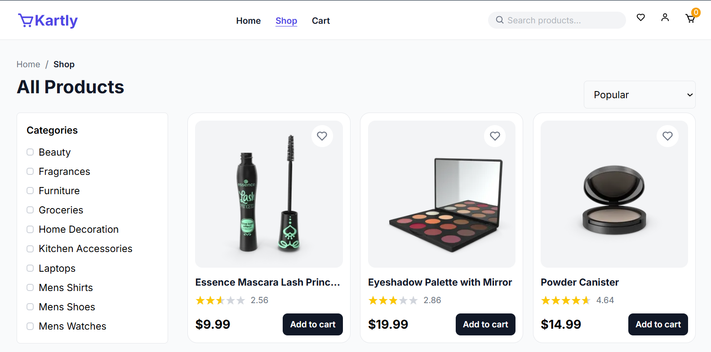
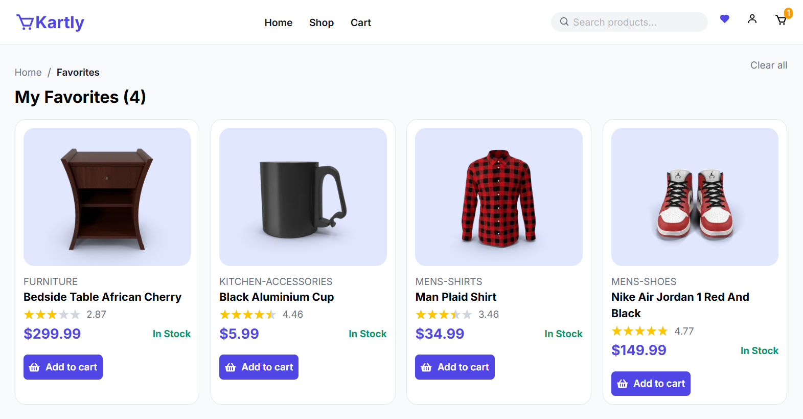

# Kartly – React E-Commerce Store

Kartly is a modern, responsive e-commerce frontend built with React. It provides a smooth shopping experience with product browsing, search, shopping cart management, and favorites functionality.

🔗 **Live Demo:** [https://kartly-shop.vercel.app/](https://kartly-shop.vercel.app/)

## Screenshots

### Home


### Shop



### Favorites



## Features

- **Product Browsing** – Browse products across different categories.
- **Product Details** – View individual product information.
- **Product Search** – Search products by name using a dynamic search dropdown.
- **Shopping Cart** – Add products, manage quantities, remove items, and calculate totals.
- **Favorites / Wishlist** – Save favorite products and manage your wishlist.
- **Persistent Storage** – Cart and favorites data persist using localStorage.
- **Responsive Design** – Optimized layouts for desktop, tablet, and mobile devices.
- **Reusable Components** – Modular React components for maintainable code.
- **Empty States** – Reusable empty state UI for cart and favorites.

## Tech Stack

- React
- JavaScript
- Tailwind CSS
- React Router
- React Context API
- useReducer
- localStorage
- React Icons
- DummyJSON API
- Vite

## Installation

Clone the repository:

```bash
git clone YOUR_REPOSITORY_URL
```

Navigate to the project directory:

```bash
cd kartly
```

Install dependencies:

```bash
npm install
```

Start the development server:

```bash
npm run dev
```

## API

Kartly uses the [DummyJSON API](https://dummyjson.com/) to fetch product data.

## Learning Objectives

This project helped me practice and improve my skills in:

- React component architecture and reusability.
- State management using Context API and useReducer.
- Managing application state across multiple components.
- React Router navigation.
- Working with external APIs.
- Persisting data using localStorage.
- Building responsive user interfaces with Tailwind CSS.

## Author

**Faizullah Hussain**

- GitHub: [FaizullahHussain](https://github.com/FaizullahHussain)
- Portfolio: [Visit Portfolio](https://faizullahhussain.github.io/portfolio/)

---

⭐ If you find this project interesting, feel free to explore the repository.
